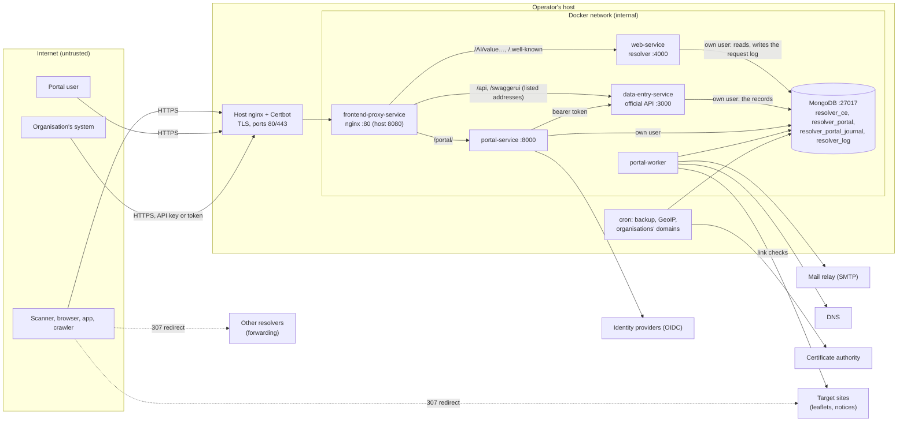

# Threat model

The system's assets, the parties that may harm them, the ways in, the controls that exist — each with the place in
the code that proves it — and the controls that are missing. Written as Phase 0 of the security assessment
([ADR 0020](adr/0020-security-assessment.md)) on 14 November 2026.

## Contents

1. [Purpose and scope](#1-purpose-and-scope)
2. [System overview](#2-system-overview)
3. [Assets](#3-assets)
4. [Actors](#4-actors)
5. [Entry points](#5-entry-points)
6. [Threats](#6-threats)
7. [Patient-safety hazards that are not attacks](#7-patient-safety-hazards-that-are-not-attacks)
8. [Security controls in place](#8-security-controls-in-place)
9. [Gaps and recommended controls](#9-gaps-and-recommended-controls)
10. [Plan for the code review](#10-plan-for-the-code-review)
11. [Assumptions and open questions](#11-assumptions-and-open-questions)

## 1. Purpose and scope

**Intended use considered.** The resolver is to be validated, in future, as part of a healthcare information chain: a
QR code or Data Matrix on a medicine or a medical device is resolved to its electronic leaflet, product information,
safety information or recall notice. A wrong, missing, stale or attacker-chosen answer can therefore reach a patient
or a professional. Impact is judged first by that consequence, then by the consequence for the operator and the
organisations that register links.

**What is covered.** The software of this repository as installed by `scripts/install.sh`: the front-end proxy, the
resolver (`web_server/`), the official data entry API (`data_entry_server/`), the portal and its worker (`portal/`),
MongoDB, the home page, the host's reverse proxy and scheduled scripts (`scripts/`), and the build and test pipeline.

**What is not covered.** The content of the target sites; the scanning apps and phones; the operator's host, network
and staff procedures beyond what the installer sets up; the identity providers, mail relay, DNS and certificate
authority themselves (they appear as parties that can fail or be compromised); physical labels and printing.

**Frameworks.** OWASP ASVS (level 2, level 3 for the routing decision and the audit trail), IEC 81001-5-1, ISO 14971,
GAMP 5 and the ALCOA+ data-integrity principles, and the Brazilian data protection law (LGPD) are used as a lens to
ask questions. **Nothing here claims conformance to any of them.**

**Method.** The documents describe intent; the code is the evidence. Each control cites `path:line` and was read in
the code; statements marked *not verified* were taken from documents or configuration without a run. Threats use
STRIDE (spoofing, tampering, repudiation, information disclosure, denial of service, elevation of privilege). Ratings
are likelihood × impact on three levels each. Weaknesses that are not yet fixed are described as missing or partial
controls; their details are kept in a private register until fixed.

**Maintenance.** This document changes with any change to a route, a role, a service, a stored collection, an external
party or a control (`CLAUDE.md`, *Keep the documents in step*), and is reviewed at each release.

## 2. System overview

### 2.1 Services and what each exposes

| Service | Reachable from the internet | Internal only | Evidence |
|---|---|---|---|
| Host nginx | 80, 443 for the installation's name and each organisation's verified domain, HTTP/1.1 only; passes every path on for the installation's name, only the resolver's on an organisation's domain (the portal's addresses redirected to the installation's name, the data entry API refused; ADR 0045) (kept up to date by the installer, ADR 0042) | — | `scripts/templates/nginx-site-https.conf:1-32`, `scripts/custom-domains.sh:133-217` |
| `frontend-proxy-service` | through the host proxy: `/` and `/home/` (static), `/portal/`, `/api` and `/swaggerui` (to the addresses of `DATA_ENTRY_API_ALLOW` only; empty by default), everything else to the resolver | port 8080 on the host, bound as `PROXY_BIND_ADDRESS` (loopback unless `.env` says otherwise, ADR 0030) | `frontend_proxy_server/nginx.conf:58-122`, `docker-compose.yml:172` |
| `web-service` (resolver) | `/{AI}/{value}[/{qualifier}/{value}…]`, compressed links and EPC forms (one segment), `/.well-known/gs1resolver`, `/_click`, `/_brand/{prefix}`, `/favicon.ico`, `/robots.txt`, `/heartbeat` (with `settings`: `current` or `stale`, the only internal state it tells anyone, ADR 0053); GET, HEAD, OPTIONS; no authentication | port 4000 | `web_server/src/web_namespace.py:24-227` |
| `data-entry-service` | `/api/new`, `/api/validate`, `/api/summary`, `/api/index`, `/api/{AI}/{value}` (GET, PUT, DELETE), `/api/docs`; bearer token; `/api/heartbeat` open | port 3000 | `data_entry_server/src/data_entry_namespace.py:54-65`, `:68-292` |
| `portal-service` | pages, `/portal/api/*` (session), `/portal/api/v1/*` (API key), sign-in, recovery and SSO routes, `/portal/healthz` | port 8000 | `portal/app.py:696-3576`, `portal/api_v1.py:109-249` |
| `portal-worker` | nothing | jobs, housekeeping, monitoring; outbound HTTP, DNS, SMTP | `portal/app.py:3559-3566` |
| `database-service` | nothing when bound to loopback (the default, ADR 0030) | port 27017, bound as `DATABASE_BIND_ADDRESS` | `docker-compose.yml:19`, `scripts/install.sh:307` |

### 2.2 Data stores

| Database | Collections that matter | Written by | Read by |
|---|---|---|---|
| `resolver_ce` | `gs1resolver`: one document per key, every record (qualifier set) and its links | data entry API (role `dataEntryService`: find, insert, update, remove there only) | resolver (role `resolverService`: find), data entry API |
| `resolver_portal_journal` | `journal` (audit trail and versions, sealed in hash chains), `journal_heads`, `journal_moved` (ADR 0026 §2.5.2) | the portal and worker insert (role `journalAppend`: events read and inserted only, heads moved forward); `portal-db-init` (root) moves, re-dates and seals | portal, worker |
| `resolver_portal` | `users`, `tenants`, `record_meta`, `api_keys`, `sessions`, `tokens`, `sso`, `domains`, `domain_hosts`, `branding`, `forwarding_rules`, `settings` (appearance, forwarding fallback, retention, locks), `jobs`, `login_failures`, `anonymous_failures`, `request_daily`, `api_requests`, `alert_history`, `gcp_table` | portal, worker; the domains script (`domain_hosts`) | portal, worker; the resolver reads `tenants`, `domains`, `branding`, `forwarding_rules`, `settings` and nothing else there (role `resolverService`, `portal/db_init.py`; ADR 0030) |
| `resolver_log` | `requests`, `request_counts` | resolver (role `resolverService`: insert, update, indexes) | portal (read, prune: `portal/db_init.py:42`) |
| Files | `.env` (every secret, mode 600), the `resolver-portal-config` volume (fallback session key), `/var/backups/resolver`, `./geoip` | installer, scripts | services, scripts |

### 2.3 Trust boundaries

1. **Internet → host proxy.** Everything arriving is untrusted, including the `Host` and `X-Forwarded-*` headers.
2. **Proxy → services.** The services trust the proxy for the public host name and the client's address.
3. **Portal → data entry API.** The portal holds the API's token and is the only place where organisations,
   prefixes, roles and the target rule are enforced; the API itself knows none of them.
4. **Services → MongoDB.** Each service has its own user with the least privileges it needs, made by `portal-db-init`,
   the only service given the root user ([ADR 0030](adr/0030-least-privilege-services.md)).
5. **Organisation ↔ organisation.** Separation is derived at query time from GS1 Company Prefixes
   (`portal/tenants.py:69-78`), not stored on the records.
6. **Operator ↔ organisation.** Server administrators see an organisation's data only through support access.
7. **Portal and worker → outside.** Requests to addresses supplied by users (targets, identity providers, domains).
8. **Resolver → target.** The redirect hands the person over to a site the resolver does not control.
9. **Repository → running system.** Images are built on the server from the checkout and public registries.

## 3. Assets

Ranked by the harm their loss causes; I = integrity, A = availability, C = confidentiality.

| # | Asset | Why it matters | Property |
|---|---|---|---|
| A1 | The routing decision of each request | It decides which leaflet, notice or page a person receives | I, A |
| A2 | Records of safety-critical link types (`gs1:epil`, `gs1:smpc`, `gs1:eifu`, `gs1:recallStatus`, `gs1:safetyInfo`) | A changed or deleted target misinforms silently | I |
| A3 | Every other record, default links, forwarding rules and the resolver of last resort | Wrong product information; a route to a hostile site under a trusted name | I |
| A4 | Availability of resolution | Printed codes cannot be changed; an outage removes access to safety information | A |
| A5 | Separation between organisations | One organisation must not read or change another's records, log, users or settings | C, I |
| A6 | Credentials: the data entry token, the session key, passwords, API keys, SSO client secrets, database passwords, mail password | Each opens A1–A5; the data entry token opens all of them at once | C |
| A7 | The audit trail and record history | Who changed what and when; the means to restore | I, A |
| A8 | Organisations' domains and brands | A domain in printed codes; the name and logo a person sees | I |
| A9 | The request log and access logs | Scans by place, time and code; personal data when combined | C |
| A10 | Users' personal data (names, e-mail addresses, sign-in history) | LGPD | C |
| A11 | Configuration, backups and the build pipeline | Hold or produce everything above | C, I |

## 4. Actors

| Actor | Starts with | Wants | Notes |
|---|---|---|---|
| Anonymous internet, including automated and AI-driven scanning at scale | The public routes | Any weakness; exhaustion; credentials | Assumed continuous and cheap |
| A scanned code or malicious label | A crafted GS1 Digital Link or a look-alike domain | To make a trusted name lead somewhere else | The person trusts the name in the code |
| A user of another organisation | A valid session or API key elsewhere | Another organisation's records, log, users | The main multi-organisation threat |
| A malicious or careless editor | Editor role in their own organisation | Wrong targets; damage by import or deletion | Carelessness is more likely than malice |
| A compromised organisation administrator | Users, API keys, SSO, domains, brands of one organisation | Persistence; reach outside the organisation | |
| The server administrator and support access | Everything in the portal; the host | — | Trusted, but must be attributable |
| A compromised identity provider | Tokens for an organisation's e-mail domains | Accounts of that organisation | The operator's own provider reaches server administrators |
| A compromised target site or lapsed domain | The page behind a link; a domain once verified | Hostile content under a valid code | Outside the system, visible to it only by checks |
| Supply chain | A dependency, base image, action or the syntax engine | Code execution in a service or in CI | |
| The operator's host or a backup | `.env`, the Docker socket, archives | Everything | Out of scope beyond what the scripts set up |

## 5. Entry points

### 5.1 External

| # | Entry point | Authentication | Handler |
|---|---|---|---|
| E1 | GS1 Digital Link paths, with `linkType`, `context`, `Accept`, `Accept-Language` | none | `web_server/src/web_namespace.py:163-227`, `:251-264`, `:425-539` |
| E2 | Linkset and JSON-LD (`linkType=linkset`, `Accept`), the item's page, `/_click`, `/_brand/` | none | `web_namespace.py:487-508`; `web_server/src/landing.py:261-343` |
| E3 | Compressed links and EPC binary forms (one segment); `?compress=` | none | `web_namespace.py:104-160`, `:267-296` |
| E4 | `/.well-known/gs1resolver` | none | `web_namespace.py:306-351` |
| E5 | Official data entry API and its Swagger UI | one bearer token | `data_entry_namespace.py:68-292` |
| E6 | Portal pages and `/portal/api/*` | session cookie; role; prefixes | `portal/app.py:315-394` |
| E7 | Tenant API `/portal/api/v1/*` | API key with scopes | `portal/api_v1.py:43-68` |
| E8 | Sign-in, sign-out, password change | password; throttle | `portal/app.py:974-1070` |
| E9 | Password recovery and invitation links | single-use token by e-mail | `portal/app.py:1096-1174`; `portal/tokens.py` |
| E10 | Single sign-on start and callback | the provider's ID token | `portal/app.py:3196-3231`; `portal/sso.py:303-368` |
| E11 | Uploads: logos and icons (base64 in JSON), spreadsheets (base64 in JSON), the GCP table (XML, gzip) | session; role | `portal/branding.py:89-112`; `portal/sheet.py:111-161`; `portal/gcp.py:83-140` |
| E12 | Home page and its assets; public portal assets, appearance, privacy notice, About page and `GET /portal/api/about` (ADR 0024), OpenAPI description, `healthz` | none | `nginx.conf:58-75`; `portal/app.py:717-851`, `:1177-1190` |
| E13 | The `Host` header: the installation's name (`FQDN`, `FQDN_ALIASES`), an organisation's domain with its path stem, any other name (answered, never written: ADR 0039) | none | `web_server/src/domains.py` |
| E14 | The query string, passed whole to the target | none | `web_namespace.py:392-398`, `:511-521` |

### 5.2 Internal

| # | Entry point | Runs as | Handler |
|---|---|---|---|
| I1 | Worker jobs: imports, link checks, mail | the portal's user, the job owner's scope (an import's account read again before each record, ADR 0041) | `portal/app.py:1940-1984`, `:2071-2106` |
| I2 | Link checker, domain check, SSO discovery, monitoring probes (outbound HTTP) | portal, worker | `portal/outbound.py`; `portal/linkcheck.py`; `portal/domains.py` `probe()`, `check()`; `portal/sso.py` `_send()`, `discovery()`, `finish()` |
| I3 | DNS proof of domains, looked at again daily | worker, portal | `portal/domains.py` `verify()`, `recheck_all()`; `portal/sso.py` `verify_domain()`, `recheck_proofs()` |
| I4 | Forwarding rules and caches read by the resolver | resolver, its own database user (find only) | `web_server/src/forwarding.py`; `domains.py:53-77` |
| I5 | Backup, restore rehearsal, secret rotation, GeoIP update | root on the host, cron | `scripts/*.sh` |
| I6 | Organisations' domains on the host: nginx sites and certificates from database content | root on the host, every 5 minutes | `scripts/custom-domains.sh:254-309` |
| I7 | Installer and upgrade script | root on the host | `scripts/install.sh`, `scripts/upgrade-from-official.sh` |
| I8 | Build: Dockerfiles, package registries, the syntax engine's source | Docker build | `*/Dockerfile`, `portal/tools/build-syntax-engine.sh` |
| I9 | CI | GitHub Actions | `.github/workflows/*.yml` |

## 6. Threats

L = likelihood, I = impact (H, M, L); rating = the pair.

### 6.1 Resolution (E1–E4, E13, E14)

| ID | STRIDE | Threat | Controls in place | Residual gap | L × I |
|---|---|---|---|---|---|
| T-R1 | T | A request is crafted so that the redirect leads somewhere other than the registered target | Targets come from the record only; the click route looks the link up again and never takes an address from the request (`landing.py:302-329`); path values are checked by the GS1 Barcode Syntax Engine before any lookup (`web_logic.py:118-140`, `:322-332`) | Records with template qualifiers, which the official API accepts and the portal does not create: the request's value is put into the stored links string by string, percent-encoded inside an address (`web_logic.py`, `_substituted()`; the official code built them as JSON text, where a value could change the target) | L × M |
| T-R2 | T, S | A hostile `Host` makes the resolver describe itself under another name | The proxy sets `X-Forwarded-Host` from the request; the resolver writes a name only when it is `FQDN`, one listed in `FQDN_ALIASES` or an organisation's verified domain, any other gets `FQDN` (anchors, `Link` and `Resolution-Anchor` headers, the description file; `domains.known_names()`, `public_name()`); the proxies' own redirects carry the path alone or the installation's name (`absolute_redirect off`, `$server_name`; [ADR 0039](adr/0039-known-public-names.md)); an organisation's domain answers for its own prefixes only (`domains.py`, `web_namespace.py`) | The host's nginx passes every name to the installation, which answers it (with `FQDN` written); the list of names is kept in step with the host's sites by hand | L × L |
| T-R3 | D | Automated requests exhaust the resolver | Syntax check in process (`web_server/src/gs1_syntax.py`); request log written in the background with a bounded queue (`request_log.py`); stateless replicas; requests and connections limited per client address at the installation's proxy (an IPv6 address with its `/64`), 429 before any service is reached, each limit a setting with exempt addresses (`frontend_proxy_server/nginx.conf`, `api-access.sh`; ADR 0031); a one-segment path starts the GS1 Digital Link Toolkit's Node.js process only when it can be a compressed GS1 Digital Link, at most two at once in each server process, killed after 3 s, 503 with `Retry-After` when none is free, recent answers kept (`web_logic.py` `uncompress_gs1_digital_link()`, `_run_toolkit()`; [ADR 0047](adr/0047-toolkit-processes.md)) | An attacker with many addresses gets each address's share; the host's nginx has no limit of its own; decompressing a compressed GS1 Digital Link still takes a Node.js process, so a flood of distinct base64url segments can keep compressed links waiting (503) while uncompressed links and EPC binary strings are answered in process | M × H |
| T-R4 | I | Enumeration of registered codes | `/index` and `/summary` need the token (`data_entry_namespace.py:148-190`); the resolver answers per code only | Codes can be probed one at a time; no limit | M × L |
| T-R5 | T | A page of the resolver executes content supplied in a record | Templates escape by default; non-web targets are listed without a link (`web_pages.py:268-273`); JSON-LD is escaped for `<` (`landing.py:296`); colours and logos validated (`landing.py:125-128`, `branding.py:89-112`); each page runs and styles only its own elements, by a nonce drawn for each answer, is never framed and loads nothing from other sites but fonts (none on the item's page); `nosniff` ([ADR 0038](adr/0038-browser-hardening.md) §2.2) | They share the portal's origin | L × M |
| T-R6 | T | A stale answer served after a change | Changes take effect at once in the database; caches of domains, brands and forwarding last 30–60 s; once a cache has not been read for `RESOLVER_SETTINGS_MAX_AGE_S` (15 minutes by default) forwarding, brands and appearance are no longer applied, the other caches keep their values, and the portal alerts (`settings_age.py`, [ADR 0053](adr/0053-settings-age.md)) | No explicit `Cache-Control` on redirects (not cacheable by default; a proxy in front may differ); within the limit, and for domains, strict mode and retention after it, caches keep the last value while the database is unreachable | L × L |
| T-R7 | I | The query string carries personal or session data to the target | Passed whole, as the standard requires (`web_namespace.py:511-521`); the request log keeps AI names of attributes only | Inherent to the standard; say so in the privacy notice | M × L |

### 6.2 Data entry and integrity (E5, E6, E7, I1)

| ID | STRIDE | Threat | Controls in place | Residual gap | L × I |
|---|---|---|---|---|---|
| T-D1 | S, T, R | Someone with the data entry token changes any record, outside every portal rule | Constant-time comparison (`data_entry_namespace.py:54-65`); the installer generates the token (`install.sh:649`); `/api` and `/swaggerui` closed at the proxy to every address not in `DATA_ENTRY_API_ALLOW`, the client read from `X-Forwarded-For` of trusted proxies only (`frontend_proxy_server/nginx.conf`, `api-access.sh`; ADR 0021) | One static, unscoped, unexpiring token for everything; no trace of such changes in the audit trail; targets follow the portal's rule ([ADR 0048](adr/0048-data-entry-target-rule.md)) but not an organisation's list of hosts | M × H |
| T-D2 | T | An editor registers a wrong or hostile target | HTTPS only, no control characters; user information, address literals and names that are not public refused in every write through the portal, in forwarding destinations and in every target sent to the official data entry API (`data_entry_server/src/target_rule.py`; [ADR 0048](adr/0048-data-entry-target-rule.md), a target the key already holds accepted as it is); an optional list of hosts per organisation (and for the operator's keys) that every target must match (`gs1.target_host_problem()`, `portal/targets.py`, `build_document()`; [ADR 0037](adr/0037-target-addresses.md)); link check at each save; history with restore (`journal.py:115-121`) | No second approver; the list is optional and the same for every link type; records saved before keep their targets; a public name may resolve to a private address; no notification of changes | M × H |
| T-D3 | T | Concurrent writers overwrite each other | Users' and tenants' changes run under a shared lock (`store.py:196-218`); every write of a key's document in the data entry API is conditional on the document as read, applied again on top of another writer's change, 409 when the key keeps changing (`data_entry_logic._write_document()`, `data_entry_db.write_document_if_unchanged()`, `create_document()`; the portal's `upstream.conflict`; ADR 0027) | A save from an editor opened earlier still replaces another user's save of the same record (last save wins; both versions in the journal): no revision carried from the editor's read to its save (ADR 0027 §4) | L × M |
| T-D4 | T, D | Deleting or rewriting one record damages the key's other records | One record removed by the data entry API's record-level delete, one conditional write of the key's document, the other records untouched (`data_entry_logic.delete_record()`, `data_entry_db.write_document_if_unchanged()`, `portal/app.py` `remove_record()`; ADR 0023); fixing serial numbers writes the new record before removing the old one, after `POST /api/validate` | A conflict on the second call of a save that removes links leaves the first applied (`upstream.partialUpdate`; T-D3) | L × M |
| T-D5 | T | A spreadsheet import overwrites many records wrongly | Preview with create/update/unchanged per record before anything is written (`app.py:1775-1932`); every editor rule applied per row; the account, its role and prefixes read again before each record in the worker, an account that may no longer write stopping the import (ADR 0041, T-T5); cancel; journal entry per record | No approval step for large or safety-critical changes; no one-step undo of an import | M × H |
| T-D6 | D | A crafted spreadsheet exhausts the portal | 700 KB and 5 000 rows (`sheet.FORMATS`); reading stops at the row limit, 64 columns a row, an XLSX file measured unpacked (32 MB) before it is opened (`sheet.read_table()`, [ADR 0032](adr/0032-spreadsheet-reading-limits.md)); 1 MB request limit (`app.py:150`, `nginx.conf:121`); request limits per address (ADR 0031) | The preview runs in the web process: several editors importing at once take several workers' time, each bounded | L × L |
| T-D7 | R | A change cannot be attributed, or the trail is altered | Journal entry with user, time, content for every record change, sign-in and administrative action (`journal.py:1-30`); API changes attributed to the key (`api_v1.py:67`); per-organisation trail; operator's actions on an organisation marked (`write_event()`); a record change journalled before the data entry API is called and refused when it cannot be, a failed one followed by `change-failed` (`journal_first()`); every event sealed in a hash chain per trail and retention category with an HMAC whose key stays outside the database, verified by administrators and daily by the worker, heads logged and kept as receipts, a broken chain an alert by e-mail to the server administrators; the journal in a database of its own where the portal's database user may only read and insert events (`db_init.py` role `journalAppend`) (`journal.py`, `monitor.py` `check_journal()`, ADR 0026; F-008) | Other events still written after their change (same database); an attempt cut short by a crash stays without an outcome; whoever holds the root database user, or the portal's and its `journal_heads` (heads only, detected as truncation), can still alter the trail (detected by the chains); settings such as `journalVerified` stay in the portal's database, so the portal's user can delay the alert until the next daily check; the alert waits for the daily verification or an administrator's, and server administrators can switch alerts off; whoever holds `PORTAL_JOURNAL_KEY` and the database can rewrite a chain after the last kept receipt; no reason for change; changes through the official API unrecorded | M × H |
| T-D8 | D, T | A malformed request body makes a route fail half-way (an error 500 with a stack trace in the log), or a query operator sent where a value goes reaches a database filter | Every JSON body of a write to the portal's API is parsed and checked before its route runs (`app.py` `same_origin_only()`, `bodies.py`): not one JSON object (an array, a text, a number, `null`, broken or nested past the parser) → 400 `request.jsonInvalid`; a field of `bodies.FIELDS` of another kind (texts, flags, lists of texts, rows of objects checked by the same table, labels and qualifiers as objects of texts, the key's record) → 422 `request.fieldInvalid` with its path; so no field of the table brings an object where a user name, token or tenant id goes ([ADR 0040](adr/0040-request-bodies.md); F-023, F-029); every write route swept with every kind of value by `test_malformed.py` | Fields outside the table rely on their routes' own checks (proved only by the sweep); the resolver's web server and the official data entry API were not swept | L × L |

### 6.3 Separation between organisations (E6, E7)

| ID | STRIDE | Threat | Controls in place | Residual gap | L × I |
|---|---|---|---|---|---|
| T-T1 | E, I | A user reads or changes another organisation's records | Scope set from the account at every request (`app.py:294-335`); every record route calls `check_access` or `allowed` (`app.py:401-415`, e.g. `:1320`, `:1380`, `:1506`, `:1629`, `:2659`, `:3107`, `:3436`, `:3448`; `api_v1.py:93-97`); prefixes never overlap between organisations (`tenants.py:94-106`); verified by a run in this phase | The data entry API returns every organisation's records to the portal and each caller filters: one missed filter exposes everything; needs an exhaustive matrix test | L × H |
| T-T2 | E | An organisation's administrator acts on another organisation's users, keys, domains, brands, SSO, limits | Each screen scopes by the account's organisation (`app.py:2196-2203`, `:2325-2364`, `:2918-2928`, `:3034-3040`, `:3238-3246`; `branding.py:71-86`; `users.py:181-196`) | QR code domains: an unproved claim blocks nobody (several organisations may claim a name, the first proved keeps it, claims expire after 7 days; [ADR 0035](adr/0035-domain-claims-and-lapsed-proofs.md)); SSO e-mail domains count only once proved by DNS or a server administrator, one configuration per domain (finding F-006, [ADR 0025](adr/0025-sso-domain-proof-and-subject.md)) | M × M |
| T-T3 | I | The request log, audit trail or statistics of another organisation | Filters built from prefixes (`requestlog.py:364-382`); audit scope (`journal.py:123-130`); API calls by organisation (`requestlog.py:876-879`) | E-mail addresses are unique per organisation, so refusing one tells nothing about other organisations; recovery by address and single sign-on look per account and per organisation ([ADR 0036](adr/0036-names-and-addresses-across-organisations.md)). User names are the installation's sign-in names: an organisation's administrator can still learn that one exists elsewhere, at most 5 refusals in 15 minutes, each one for another organisation's name journalled in the operator's trail | L × L |
| T-T4 | E, R | The operator reads an organisation's data without trace | Support access: read only, with a reason, recorded in the organisation's trail (`app.py:2620-2650`, `:294-312`) | The reason is free text; no time limit other than the session's; the organisation is not notified | L × M |
| T-T5 | E | A queued import keeps writing for an account an administrator has since removed, disabled or demoted, or whose organisation was disabled (finding F-024) | The worker reads the account before each record and sets the scope from it as a request does; removed, replaced (another creation date or organisation), disabled, organisation disabled or below editor stops the import (`import.accountChanged`), journalled as `import-refused` in the organisation's trail ([ADR 0041](adr/0041-queued-import-account.md); `app.py` `import_refusal()`, `run_import_job()`) | Ending sessions or resetting a password does not stop a queued import; an account removed and made again within the same second in the same organisation passes; no e-mail tells the user | L × L |
| T-T6 | S, I | An organisation's own domain serves the operator's portal and the official data entry API: people learn to sign in on a name the organisation controls and may point elsewhere later; the portal's cookie and links on that name; the data entry API offered on it (finding F-027) | The host's sites of organisations' domains include a rule written by `custom-domains.sh`: the portal's addresses answered 302 to the installation's portal (`PORTAL_ORIGIN`, `RESOLVER_PUBLIC_URL` or `FQDN`), `/api` and `/swaggerui` 404, the prefixes of the installation's proxy; sites written before changed at the next scheduled run, nginx tested first and a refused site put back; stems the proxy would give to something else refused by the portal ([ADR 0045](adr/0045-organisation-domains-resolver-only.md)) | Sites written by hand and names reaching the installation's own site still reach the portal; the home page is still shown at the root of an organisation's domain; a domain saved before with a stem now refused keeps it | L × M |

### 6.4 Authentication and sessions (E8–E10, E7)

| ID | STRIDE | Threat | Controls in place | Residual gap | L × I |
|---|---|---|---|---|---|
| T-A1 | S | Password guessing | 12-character minimum (`users.py:39`); salted slow hashes (`users.py:35`, `:215`); a delay per user name and address after three failures (15 seconds doubling up to 15 minutes) and 20 failures per address → 15 minutes, never a lock by user name alone, shared by replicas (`app.py` `LoginThrottle`, `login()`); 60 sign-in requests a minute per address at the proxy (`PROXY_LIMIT_SIGNIN`, ADR 0031); failures naming no account counted per hour, one journal event an hour, so new user names do not fill the trail (`failcount.py`); the address is the one the proxy resolved through its trusted proxies, set alone in `X-Forwarded-For` (`nginx.conf`, `real_ip`; `app.py` `client_address()`); equal time for unknown users (`users.py:53`, `:102-109`); the owner notified at five failures in 15 minutes from any addresses | No second factor; no check against known-breached passwords; a per-address limit is evaded by an attacker with many addresses | M × H |
| T-A2 | D | Accounts locked by a third party | No lock by user name alone: failures delay only the address they come from (finding F-005); a recovery link forgets the delays (`app.py` `clear_user()`); SSO unaffected | Users behind one address (an office) share its limit of 20 failures in 15 minutes | L × L |
| T-A3 | S | Session theft or reuse | Signed cookie, `HttpOnly`, `Secure`, `SameSite=Lax`, path `/portal` (`app.py:148-159`); 30-minute idle and 12-hour absolute limits (`app.py:78-79`, `:254-290`); bound to the password's fingerprint (`users.py:112-124`); a server-side record per session, named by a random id in the cookie and stored as its SHA-256, ended at sign-out, by a password change or reset and by disabling or removing the account or disabling its organisation, so a copied cookie stops working too (`sessions.py`, ADR 0034); role, prefixes and organisation read again at every request | No list of one's sessions and no *sign out everywhere*; a copied cookie works until one of those events or its limits | L × L |
| T-A4 | S | Cross-site request forgery | Writes must come from the portal's origin and be JSON (`app.py:445-454`); `SameSite=Lax` | — | L × M |
| T-A5 | S | Recovery or invitation link abused | 256-bit token, only its hash stored, single use, 1 hour (recovery) or 72 hours (invitation), in the URL fragment (`tokens.py:45-79`); same answer and time whether or not an account matched (`app.py:1096-1121`); limits per name and address, and the proxy's sign-in limit per address (ADR 0031); security message afterwards | Depends on the mailbox; the per-address limit, as in T-A1, does not stop an attacker with many addresses | L × H |
| T-A6 | S, E | Single sign-on abused | Code flow with PKCE, state and nonce (`sso.py` `start()`); signature, issuer, audience, expiry, nonce checked, asymmetric algorithms only (`verify()`); issuer must match discovery (`discovery()`); e-mail domains proved by a DNS record or a server administrator's approval, one configuration per domain, approval refused for a domain other organisations' accounts use (`verify_domain()`, `approve_domain()`; F-006); `email_verified` required unless the configuration says its provider never sends it; the account must exist, be enabled, belong to the configuration's organisation and, after its first sign-in, present the same provider subject (`finish()`, `users.bind_sso()`; F-007); the subject journalled; accounts never created by sign-in | DNS proofs looked at daily; one missing for 7 days lapses (still signs people in, told to the administrators, taken over by another configuration that proves the domain; ADR 0035); approvals and proofs of the upgrade never lapse; configurations from before ADR 0025 keep their domains as accepted at the upgrade until replaced by a DNS proof; trust on first use: a sign-in by someone else before the person's own binds the account (an administrator forgets it); an administrator of the provider who changes the configuration's issuer rebinds at the next sign-in (journalled as `sso-save`) | L × H |
| T-A7 | S | API key theft or guessing | 256-bit secret, hash stored, constant-time comparison (`apikeys.py:143-152`); scopes, optional prefixes, expiry of at most 365 days, revocation, last use (`apikeys.py:28-33`, `:101-129`); 120 requests a minute per key (`apikeys.py:155-168`); before authentication, the proxy's limit per address on the portal (ADR 0031); calls without a valid key counted per minute rather than stored one by one (`requestlog.record_api_call()`); creation notified | No address restriction per key | L × H |
| T-A8 | E | A user keeps rights after losing them | Scope read at each request; a disabled organisation ends its users' sessions and keys (`app.py:259-265`, `api_v1.py:55`) | A queued job is run with the account as found later, without checking the role again | L × L |

### 6.5 Browser (E6, E12)

| ID | STRIDE | Threat | Controls in place | Residual gap | L × I |
|---|---|---|---|---|---|
| T-B1 | T, E | Script injection in the portal | The front end builds the page with DOM nodes and text only (no HTML-string sinks in `portal/static/*.js`); a Content-Security-Policy allowing only the portal's own scripts and styles, `Cross-Origin-Opener-Policy`, `nosniff`, `X-Frame-Options: DENY`, `Referrer-Policy`, `no-store` (`app.security_headers()`, [ADR 0038](adr/0038-browser-hardening.md)); every browser test fails on a policy violation; label SVG escaped (`label.py:446`); logos re-read by an image library, SVG refused (`branding.py:89-112`) | The portal, the resolver's pages and the Swagger UI share one origin (ADR 0038 §2.5); the Swagger UI allows inline script | L × M |
| T-B2 | T | Formula injection through exports | Cells starting with a formula character are neutralised (`sheet.py:93-96`; `app.py:2698`, `:2807`) | — | L × L |
| T-B3 | I | Clickjacking, downgrade | `X-Frame-Options: DENY` and `frame-ancestors 'none'` on the portal; `frame-ancestors 'none'` on the home page, the resolver's pages and the Swagger UI; HTTP redirected to HTTPS by the host proxy; `Strict-Transport-Security` for a year on every answer over HTTPS (the proxy, ADR 0038 §2.4) | HSTS without `includeSubDomains` or preload, and only when the host's proxy sends `X-Forwarded-Proto` | L × L |
| T-B4 | I | The About page tells anyone the running commit, which shows which published fixes an installation lacks; the build's Git data could carry credentials (a token in `origin`) | Only version, commit, date, the repository's public address, the operator's name and the components are answered (`about.facts()`); the origin's user names, passwords and tokens are removed and local or private addresses replaced by the official repository (`about.public_address()`); `version.json` read back only in its expected shape; the final image receives that file alone, not `.git` (`portal/Dockerfile`) | The version is public by design (ADR 0024 §2.4): an operator keeps up to date rather than hiding it; the code is public anyway | M × L |

### 6.6 Requests the server makes (I2, I3)

| ID | STRIDE | Threat | Controls in place | Residual gap | L × I |
|---|---|---|---|---|---|
| T-S1 | I, E | A user makes the portal or worker reach internal addresses | Every request to an address a user chose goes through `outbound.request()` ([ADR 0029](adr/0029-outbound-requests.md)): the name resolved once, every address global (IPv4 inside IPv6 forms included), the connection made to an address checked, never to the name resolved again (DNS rebinding), with the name kept for Host, SNI and the certificate; no proxy from the environment; user information refused; redirects never followed there, each hop of the link checker checked again; the link checker contacts HTTPS addresses only; provider addresses HTTPS and public (`sso.check_url()`); only status and final address are reported | The monitoring probe and the e-mail relay are the operator's own settings and connect by name | L × M |
| T-S2 | D | The link checker used to send traffic to third parties | 5 000 addresses per job (`app.py` `MAX_CHECK_URLS`); one check queued or running per organisation (`jobs.active()`, `linkcheck.busy`); at most 2 requests to one host at once (`linkcheck.PER_HOST`); results cached for 10 minutes; editors only | No daily budget per organisation; the record's own check (`/links/check`, up to the record's links) is not counted | L × L |

### 6.7 Infrastructure and supply chain (I5–I9)

| ID | STRIDE | Threat | Controls in place | Residual gap | L × I |
|---|---|---|---|---|---|
| T-I1 | E | A flaw in an internet-facing service reaches all data | Every service has its own database user with the least privileges it needs, made by `portal-db-init`, the only service given the root credentials: the portal its own database (`portal/db_init.py`), the resolver `find` on the records and on five collections of the portal's database and writes to its request log (role `resolverService`), the data entry API the records only (role `dataEntryService`) (ADR 0030; F-012); the portal, the resolver and the data entry API run as unprivileged users (`portal/Dockerfile`, `web_server/Dockerfile`, `data_entry_server/Dockerfile`), and their final images install no package from Debian's repository: no editor ([ADR 0050](adr/0050-error-answers.md)) | The resolver reads every document of `tenants`, `domains`, `settings`, `branding` and `forwarding_rules` (no secret may be stored there); the proxy's master process runs as root (official nginx image); file systems are writable | L × M |
| T-I2 | I, E | Default or exposed secrets and ports | The installer generates every secret, writes `.env` with mode 600, binds the database and the proxy to loopback (`install.sh`); rotation script; the composition publishes both ports on loopback unless `.env` names another address; the services refuse to start on a real domain with the example token or the example password of their own database user (ADR 0021 §2.7, ADR 0030) | MongoDB's example root password and the portal's first user's example password are warned about or applied once, not refused; a manual start without `.env` still uses the example credentials (on loopback, with `FQDN=localhost`) | L × H |
| T-I3 | T | Host scripts act on database content as root | Domain names validated again before reaching a file or a command; values passed as environment variables, never through a shell (`custom-domains.sh:52-58`, `:85-87`); the portal's address checked as a plain origin before it reaches nginx's configuration (`portal_origin()`, ADR 0045); nginx configuration tested before reload, sites changed by the script put back when nginx refuses them (`:192-197`, `:267`, `:291`) | *Not verified* on a live host | L × H |
| T-I4 | I | Backups or logs disclose data | Archives of mode 600, encrypted with age as they are written to the public key of `BACKUP_KEY_FILE` and `BACKUP_RECIPIENTS` (age missing fails the run; [ADR 0044](adr/0044-encrypted-backups-and-sealed-secrets.md)); credentials stay inside the database container; off-server copy; restore rehearsal decrypting; the SSO client secrets sealed in the database (AES-256-GCM, `PORTAL_DATA_KEY`); the proxy's access log minimal by default (time, method, the path's first segment, status, size, time taken: no address, query string, User-Agent or referrer; `PROXY_ACCESS_LOG`), no access log in gunicorn or the host's sites, every container's output bounded (`LOG_MAX_SIZE`, `LOG_MAX_FILES`) ([ADR 0043](adr/0043-access-logs.md)) | Losing the backup key loses the backups encrypted to it; `BACKUP_ENCRYPTION=off` writes plain archives (only a warning in the log); the data key sits on the same server (`.env` or `data.key`); nginx's error lines still name the client; host sites written before keep their access log until the operator applies the printed command; `PROXY_ACCESS_LOG=full` keeps addresses | M × M |
| T-I5 | T | A dependency, image or action is replaced, or carries a known vulnerability | Every Python package from a lock file with its file hashes (`pip install --require-hashes`), the services' locks resolved inside the tests' lock (`dev-tests/lock-dependencies.sh`); `gs1encoder` from `package-lock.json` with `npm ci --ignore-scripts`, refused at build when it is not `docker-compose.yml`'s engine release; Node.js copied from the official image (no piped script, no `npm init` initializer); every base image, the composition's mailpit and the CI's MongoDB by digest; every action by commit, checkout without credentials; Dependabot's weekly proposals; `SECURITY.md`; syntax engine release pinned in one place with a weekly check; CI with read-only permissions; a supply-chain workflow on every change of a lock, Dockerfile or workflow and weekly: pip-audit and npm audit on the locks, the five images built and scanned by Trivy (fetched by version and SHA-256), a reviewed list of accepted vulnerabilities that expire within 90 days, a CycloneDX SBOM per image attached to each release; `test_supply_chain.py` ([ADR 0033](adr/0033-supply-chain.md), F-015) | A vulnerability published between two runs is seen at the next weekly run at the latest; vulnerabilities in files of the official MongoDB image (`gosu`, the database tools, the entrypoint's `js-yaml`) accepted after review until a rebuild of that image; Alpine's and Ubuntu's packages upgraded at build, unpinned; the test tools' npm packages and the CI's downloads pinned by version or commit, not by hash; the engine's source tarball fetched by tag (`build-syntax-engine.sh`) | L × H |
| T-I6 | S, I | TLS weaknesses | TLS 1.2 and 1.3 only (`nginx-site-https.conf:18`); certificates from Certbot with renewal; expiry monitored 21 days ahead (`monitor.py`); mail and provider connections verify certificates (`mail.py:122-123`); HSTS from the proxy (ADR 0038 §2.4) | Traffic inside the Docker network and to MongoDB is in clear (one host assumed) | L × M |
| T-I7 | E, D | A flaw of nginx itself reaches the host that ends TLS (nginx's security release of 18 November 2026: CVE-2026-123007 in HTTP/2, code execution) | The installer installs or updates the host's nginx on every run and warns when its package predates the fixes (`install.sh` `check_host_nginx()`, `HOST_NGINX_FIXED`); the HTTPS site serves HTTP/1.1 only and a kept site serving HTTP/2 is reported with the command that removes it; the proxy image by digest, updated by Dependabot (1.30.7) ([ADR 0042](adr/0042-host-nginx.md)) | Updates between runs rely on Ubuntu's unattended upgrades; the version table changes with each advisory; sites written before keep `http2` until the installer runs again | L × H |

## 7. Patient-safety hazards that are not attacks

In the manner of ISO 14971: situations in which the system behaves as designed, or fails without an adversary, and a
person may still receive wrong or no information. Behaviours marked *observed* were run in this phase.

| ID | Hazard | Cause | Possible consequence | Mitigation in place | Proposed mitigation |
|---|---|---|---|---|---|
| H-1 | A request for a batch that has no record of its own is answered with the product-level link of the same type | The walk-up of GS1-Conformant Resolver 2.5.9–2.5.10 (`web_logic.py:449-466`, `:794-805`). *Observed* for `gs1:recallStatus`: an unregistered batch, a batch differing only in letter case, and a serial number without its batch all received the product-level notice | A recall registered for one batch is missed; a batch-specific leaflet is replaced by the general one; nothing tells the person or the app which level answered | The record list flags keys without a record of their own; the request log keeps the answering level (`web_namespace.py:457-459`); a 307 or 300 names it in `Resolution-Anchor` and `Resolution-Match`, and the item's page and the 300 page show a notice when a less specific level answered; an organisation (or the operator) may switch on the strict mode, which withholds a safety-critical link held only by a less specific level from a request naming a batch or serial (404, `Resolution-Match: withheld`, the request log's `withheld`); the portal warns, without refusing, when a batch or serial record lacks a safety-critical type a broader record holds, when a product-level record holds them while batches exist, and when a batch or serial value differs from an existing one only in case, spaces, punctuation or O/0 and I/1 (editor, tenant API, import preview, the organisation's *Resolution* tab) ([ADR 0022](adr/0022-answering-level.md)) | Alert on walk-ups for `recallStatus` |
| H-2 | A plain scan (no link type) opens the default link, which says nothing about a recall | The default link of the most specific record wins (`web_logic.py:601-618`) | A recalled product looks normal | The item's page lists every link, safety types with an alert icon (`landing.py:60-68`) | For records holding `recallStatus`/`safetyInfo`, offer or require the item's page as default, safety links first |
| H-3 | A wrong target is registered | Typing or copy error; wrong spreadsheet column | Wrong leaflet | Link check at save; preview; history | Second approver and change notification for safety-critical types; target allowlist |
| H-4 | A target stops working or changes content | Site reorganised; domain lapsed | Dead link or unrelated content | Link checker on demand, problems in the record list and overview (`app.py:2109-2182`); HTTPS→HTTP redirects reported | Scheduled checks for safety-critical links with alerts; optional content fingerprint to detect a changed document |
| H-5 | The wrong key or qualifier is registered | A valid GTIN of another product; batch typed differently from the printed one | The right leaflet under the wrong code | Check digits, formats and qualifier rules by the GS1 engine (`portal/gs1.py`, `data_entry_logic.py` `registration_problem()`, `value_problem()`); prefix must belong to the organisation; GCP table comparison (`gcp.py`) | Product master data comparison where available; "try now" scan before publishing |
| H-6 | A leaflet in a language the person did not ask for, or for another market | No link serves the requested language or context: the remaining links are used (`web_logic.choose_links()`). *Observed* before ADR 0028: an English leaflet for a pt-BR request; an unknown `context` ignored, both silently | Information not understood, or not valid in the person's country | The item's page marks the language of each link; a 307 or 300 whose links do not serve the language or context asked carries `Resolution-Fallback`; for the five safety-critical types a browser receives the page of a choice with a notice in its language instead of the redirect; the portal warns, without refusing, on safety-critical links without a language and on languages a record has for other links but not for its safety-critical types (editor, tenant API, import preview) ([ADR 0028](adr/0028-language-fallback.md)) | A list of an organisation's languages and markets; a count of answers not served |
| H-7 | The default link points somewhere generic | The key's default link type is shared by its records (`app.py:1432-1438`) | Marketing page instead of instructions | The editor shows the shared default | A recommended default per product category (healthcare: leaflet or item's page) |
| H-8 | The item's page shows the wrong brand | The longest matching prefix wins; a prefix moved to another organisation takes its brand (`landing.py:95-102`, `branding.py:55-62`) | Confusion about who is responsible | Brands limited to the organisation's own prefixes | Show the change of prefix ownership to both organisations; confirm brands after a move |
| H-9 | An import overwrites good records | A stale export imported again | Old leaflets restored | Preview, unchanged detection, journal | Refuse or warn when the file is older than the records it changes; one-step undo |
| H-10 | Restoring an old version brings back an obsolete target | Restore loads the version into the editor; saved through the normal rules (`static/app.js:2388`) | Withdrawn leaflet published again | Nothing is saved until the user saves; link check | Mark versions older than a withdrawal; approval for safety-critical types |
| H-11 | Deleting one record removes the key's others for a time | Closed: the record-level delete removes one record in one write (ADR 0023); before it the key was rewritten in two calls | No answer for the product | The record-level delete; a failed delete leaves every record | — |
| H-12 | An organisation's domain lapses or is repointed | The DNS proof disappears; the domain stays verified so that printed codes keep resolving here | Printed codes lead elsewhere | Daily look at the DNS proof; missing for 7 days the domain lapses: no longer offered for new labels, its administrators told, taken over by another organisation that proves it (`domains.recheck_all()`, `app.recheck_domains()`; ADR 0035) | Alert when the address no longer points here; a lapsed domain is still served |
| H-13 | Forwarding sends an organisation's codes elsewhere | A rule by prefix overrides local records (`web_namespace.py:442-446`) | Leaflets bypassed | The screen shows overlapping organisations; rules can be switched off; each change that sends an organisation's codes elsewhere, or stops, is an event in its own trail and an alert to its administrators (`app.tell_forwarded()`, [ADR 0046](adr/0046-forwarding-tells-organisations.md)), and so is an organisation given a prefix a rule switched on already covers (`app.tell_covered()`, [ADR 0054](adr/0054-forwarding-tells-new-prefixes.md)) | Confirm with the number of records |
| H-14 | Unknown codes go to another resolver | Resolver of last resort (`web_namespace.py`, `_process_response()`) | The person lands on a third party's answer | Off by default; counted in the overview; never while the records' database cannot be read: a code is unknown only when the database says so ([ADR 0051](adr/0051-records-unavailable.md)) | Explain on the organisation's page; exclude an organisation's own prefixes if wanted |
| H-15 | A change does not take effect, or an old answer persists | Caches of 30–60 s that keep the last value when the database fails; an intermediary caching redirects | A recall published late | Short cache times; a limit on the age of settings that cannot be read again, after which forwarding and brands stop, and an alert by e-mail (`settings_age.py`, the monitor's check `settings`, [ADR 0053](adr/0053-settings-age.md)) | `Cache-Control: no-store` on redirects |
| H-16 | Wrong clock | Tokens, sessions, retention and journal times use the server's clock | Early expiry; wrong audit times | — | Time synchronisation checked by monitoring |
| H-17 | Resolution is unavailable | One host, one MongoDB; overload | No information at all | Replicas, monitoring with alerts by e-mail (`monitor.py:393-420`), backups with rehearsal; an outage of the records' database answered 503 with `Retry-After` and the page that asks to try again, not as a code nobody registered (`web_logic.RecordsUnavailable`, [ADR 0051](adr/0051-records-unavailable.md)), within one time budget for all the database reads of a request (`db_budget.py`, 5 s by default, [ADR 0052](adr/0052-database-time-budget.md)) | A second site or a static emergency answer for safety-critical keys; recovery time objective (request limits per address at the proxy exist: ADR 0031) |
| H-18 | The audit trail is incomplete when needed | Journal writes are best effort | A change cannot be explained | Failure logged | Journal first, change second |

## 8. Security controls in place

| Area | Control | Evidence |
|---|---|---|
| Authentication | Passwords of at least 12 characters, salted slow hash; first user from the environment only while there is none | `portal/users.py:39`, `:215`; `portal/app.py:165-181` |
| | Temporary passwords must be changed; only four routes allowed until then | `portal/app.py:291`, `:330-333` |
| | Progressive delay per user name and address, limit per address, no lock by user name alone, shared by replicas; equal timing for unknown users | `portal/app.py` `LoginThrottle`, `login()`; `portal/users.py:53` |
| | Requests and connections limited per client address at the proxy (resolution, the portal, sign-in), 429 with `Retry-After` before any service is reached; failed sign-ins naming no account and tenant API calls without a valid key counted, not stored one by one | `frontend_proxy_server/nginx.conf`, `api-access.sh`; `portal/failcount.py`; `portal/requestlog.py` `record_api_call()` (ADR 0031) |
| | Single sign-on per organisation with OpenID Connect; password sign-in can be switched off | `portal/sso.py` `password_off_for()`, `verify()`, `finish()`; `portal/users.py` `bind_sso()` |
| Sessions | Signed cookie with `HttpOnly`, `Secure`, `SameSite=Lax`; idle and absolute limits; bound to the password | `portal/app.py:148-159`, `:254-290` |
| Cross-site requests | Origin and JSON checks on every write | `portal/app.py:445-454` |
| Request bodies | One JSON object (else 400) and the kinds of the fields a route would misread (else 422 naming the field), before every write route (ADR 0040) | `portal/app.py` `same_origin_only()`; `portal/bodies.py`; `dev-tests/portal/test_malformed.py` |
| Roles and prefixes | reader < editor < administrator; prefixes per user; server administrator; read-only support access; a queued import writes only while its account may (ADR 0041) | `portal/app.py:294-394`; `portal/users.py:181-196` |
| Organisations | Ownership derived from prefixes; non-overlapping prefixes; scope checks on every record route | `portal/tenants.py:69-106`; `portal/app.py:401-415` |
| API keys | Hashed 256-bit secrets, scopes, prefixes, expiry, revocation, limit per minute, call log | `portal/apikeys.py:28-33`, `:101-168`; `portal/api_v1.py:43-91` |
| Single-use links | Hashed, single use, short life, limits, neutral answers | `portal/tokens.py:45-79`; `portal/app.py:1096-1174` |
| Target addresses | HTTPS only; no spaces, control or invisible characters; no user information, address literal or private name; an optional list of hosts per organisation (ADR 0037); the same forms refused by the official data entry API for every target it is sent, a target the key already holds accepted (ADR 0048); non-web targets not rendered as links | `portal/gs1.py` `normalise_url()`, `target_host_problem()`; `portal/targets.py`; `data_entry_server/src/target_rule.py`; `web_server/src/web_pages.py:268-273` |
| GS1 data | Keys, qualifiers and values checked by the GS1 Barcode Syntax Engine in the portal, the data entry API and the resolver; the data entry API stores `/AI/value` anchors of a primary key only, under one document id per anchor (a value's own `_` kept, read the same way by the resolver; [ADR 0049](adr/0049-data-entry-anchors.md)) | `portal/gs1.py`; `data_entry_server/src/data_entry_logic.py` (`anchor_problem()`, `registration_problem()`, `value_problem()`, `convert_path_to_document_id()`); `data_entry_server/src/data_entry_db.py` (`_reformat_id_for_db()`); `web_server/src/web_db.py` (`_reformat_id()`); `web_server/src/web_logic.py:118-140` |
| Uploads | Logos: size, dimensions, re-read by an image library, PNG/JPEG/WebP only; spreadsheets: size, rows while reading, 64 columns, unpacked size (ADR 0032); GCP table: size, no DTD or entities | `portal/branding.py:32-34`, `:89-112`; `portal/sheet.py` (`FORMATS`, `read_table()`); `portal/gcp.py:38`, `:116` |
| Output encoding | DOM text nodes in the front end; escaping templates on the resolver; escaped SVG; neutralised CSV cells | `portal/static/*.js`; `web_server/src/landing.py:290-298`; `portal/label.py:446`; `portal/sheet.py:93` |
| Headers | A Content-Security-Policy on every answer: the portal's (own files only), the resolver's pages' (a nonce per answer), the Swagger UI's, nothing at all for the other answers, the home page's; `nosniff` everywhere; portal: `Cross-Origin-Opener-Policy`, `DENY`, `same-origin` referrer, `no-store`; resolver: `strict-origin-when-cross-origin`; HSTS on every answer over HTTPS ([ADR 0038](adr/0038-browser-hardening.md)) | `portal/app.py` (`security_headers()`); `web_server/src/web_pages.py`, `__init__.py`; `data_entry_server/src/__init__.py`; `frontend_proxy_server/nginx.conf` |
| Outbound requests | Resolved once, every address public, connected to the address checked with the name kept for TLS; HTTPS only for the link checker; each redirect hop checked; one link check per organisation, 2 requests per host at once; time limits | `portal/outbound.py`; `portal/linkcheck.py`; `portal/sso.py` `_send()`; `portal/domains.py` `probe()` |
| Domains | DNS TXT proof, looked at again daily (lapsed after 7 days missing) and claims that expire (ADR 0035); an organisation's domain answers for its prefixes only, and only the resolver answers on it: the portal's addresses redirected to the installation's name, the data entry API refused, stems that would reach something else refused (ADR 0045); host names validated again on the host | `portal/domains.py:264-287`, `clean_stem()`; `web_server/src/domains.py:147-157`; `scripts/custom-domains.sh:85-87`, `write_rule()`, `add_rule()`, `migrate_sites()` |
| TLS | TLS 1.2/1.3 at the host proxy, automatic certificates, expiry alert | `scripts/templates/nginx-site-https.conf:18`; `portal/monitor.py` |
| Secrets | Generated by the installer, `.env` of mode 600, rotation script; only `portal-db-init` holds the root database credentials, every other service its own user; client secrets never sent to a browser, and sealed in the database with the data key (ADR 0044) | `scripts/install.sh`; `scripts/rotate-secrets.sh`; `docker-compose.yml`; `portal/db_init.py`; `portal/sso.py` (`public()`, `client_secret()`); `portal/sealed.py` |
| Audit trail | Journal of sign-ins, administration and every record version, per organisation, with retention per category, record changes journalled first, sealed in hash chains and verified (ADR 0026); text logs with each chain's daily head | `portal/journal.py`; `portal/app.py` `write_event()`, `journal_first()`, `audit_verify()` |
| Error answers | Every error answer of the resolver and the data entry API carries a fixed text; the exception and its traceback go to the service's log (PyMongo's messages name the database's host and port); a test reads every `except` block of both services ([ADR 0050](adr/0050-error-answers.md)) | `web_server/src/web_logic.py` (`INTERNAL_ERROR`), `web_db.py`; `data_entry_server/src/data_entry_db.py` (`DATABASE_ERROR`, `INTERNAL_ERROR`), `data_entry_logic.py`, `data_entry_namespace.py` |
| Request log privacy | No client address, no user agent, no full referrer, no values of unit qualifiers or attributes; retention per organisation | `web_server/src/request_log.py:1-30`, `:230-290` |
| Access log privacy | The proxy's access log without the client's address, the query string, the User-Agent or the referrer unless `PROXY_ACCESS_LOG=full`; the limits' refusals out of the error log; no access log in gunicorn or the host's sites; each container's output bounded | `frontend_proxy_server/nginx.conf` (`log_format minimal`, `$log_area`); `frontend_proxy_server/api-access.sh`; `*/Dockerfile` CMD; `scripts/templates/nginx-site-*.conf`; `docker-compose.yml` `x-logging` |
| Exports | Limits per role and organisation within an installation maximum; journal entries | `portal/app.py:366-384`; `portal/exportlimits.py` |
| Backups | Daily dump encrypted with age (ADR 0044), off-server copy, restore rehearsal, alert on failure | `scripts/resolver-backup.sh`; `scripts/restore-rehearsal.sh`; `scripts/install.sh` (`backup_key()`) |
| Monitoring | Resolver, backup, certificate, log space, spikes of 404, with alerts by e-mail | `portal/monitor.py:393-420` |
| CI | More than 4,700 checks in 68 programs on every change; read-only token | `.github/workflows/dev-tests.yml:20-21` |

## 9. Gaps and recommended controls

Phrased as controls. P1: before any use with medicines or devices; P2: before validation; P3: improvement.
"Exists" means the control is already there and only its limits are noted.

### P1

| # | Control | Why (threats, hazards) | Today |
|---|---|---|---|
| G-1 | **Close the official data entry API to the internet by default**: reachable from the portal only, or from listed addresses; integrations use the tenant API | T-D1 | Done: closed at the proxy unless `DATA_ENTRY_API_ALLOW` lists the address ([ADR 0021](adr/0021-data-entry-api-closed.md)); the token's own weaknesses remain |
| G-2 | **Refuse to start with example secrets or open ports** outside development; loopback as the default bind | T-I2 | Done: the example data entry token and the example passwords of the portal's, the resolver's and the data entry API's database users refused when `FQDN` names a real host, MongoDB's example root password warned about by `portal-db-init` ([ADR 0021](adr/0021-data-entry-api-closed.md) §2.7, [ADR 0030](adr/0030-least-privilege-services.md)); MongoDB and the proxy published on loopback by default |
| G-3 | **Rate limiting at the proxy** per address: sign-in, recovery, tenant API, resolver paths that are not GS1 keys; bounded cost for every path | T-R3, T-A1, H-17 | Done ([ADR 0031](adr/0031-request-limits.md); the cost of a one-segment path bounded by [ADR 0047](adr/0047-toolkit-processes.md)): resolution, the portal and sign-in limited per client address at the installation's proxy (an IPv6 address with its `/64`), connections too; anonymous tenant API calls and failed sign-ins naming no account counted instead of stored one by one; limits per user name and per API key in the portal |
| G-4 | **Trusted-proxy handling of the client's address**, configured by the proxies in front | T-A1, T-D7 | Done: `real_ip` with `PROXY_TRUSTED_PROXIES` (and the host's nginx behind a loopback bind address), the result set alone in `X-Forwarded-For` for every service ([ADR 0021](adr/0021-data-entry-api-closed.md) §3) |
| G-5 | **Second factor for editors and administrators** (TOTP or WebAuthn; mandatory for server administrators), or SSO enforced with the provider's second factor | T-A1, T-A2 | Absent; SSO per organisation exists |
| G-6 | **Safety-critical link types as a class** (`epil`, `smpc`, `eifu`, `recallStatus`, `safetyInfo`): four-eyes approval before a change takes effect, notification of every change to the organisation's administrators, scheduled link checks with alerts | T-D2, H-3, H-4 | All link types are treated alike; link checks run on demand |
| G-7 | **Make the answering level visible and controllable**: a response field naming the record that answered; a policy for safety-critical types when the batch or serial has no record; editor warnings on conflicting levels | H-1, H-2 | Partial: a 307 or 300 names the record that answered and whether it walked up (`Resolution-Anchor`, `Resolution-Match`), and the resolver's pages say so when their links come from a less specific level ([ADR 0022](adr/0022-answering-level.md)); the strict mode for safety-critical types, per organisation and off by default, withholds a link held only by a less specific level (ADR 0022 §2.4); the portal warns on conflicting levels and near-duplicate batch or serial values (ADR 0022 §2.5); an alert on walk-ups for `recallStatus` remains |
| G-8 | **Atomic record operations with optimistic concurrency** in the data entry API: record-level delete, a revision checked on every write | T-D3, T-D4, H-11 | Mostly done: a record-level delete ([ADR 0023](adr/0023-record-level-delete.md)) and every write of a key's document conditional on the document as read, 409 when it keeps changing ([ADR 0027](adr/0027-conditional-writes.md)); still to do: a revision carried from the editor's read to its save |
| G-9 | **An audit trail that cannot be skipped or silently altered**: entry written before the change, changes through every interface recorded, hash chain with an anchor outside the database, insert-only access | T-D7, H-18 | Partly done (F-008, [ADR 0026](adr/0026-journal-integrity.md) step 1): record changes journalled first, hash chains with a key outside the database, verification, heads in the daily log and as receipts, an alert by e-mail when a chain breaks, insert-only access in a database of its own (§2.5.2); still to do: the official API's own journal |
| G-10 | **Template records reviewed, or refused,** before any installation uses them | T-R1 | The portal does not create them; the official API accepts them; their values can no longer change a target (session 28) |

### P2

| # | Control | Why | Today |
|---|---|---|---|
| G-11 | Least-privilege database users for the resolver and the data entry API; non-root containers; read-only file systems | T-I1 | Done but for read-only file systems: a user and a role per service, made by `portal-db-init`; the three Python services run as unprivileged users ([ADR 0030](adr/0030-least-privilege-services.md)) |
| G-12 | Per-organisation allowlist of target domains, mandatory for safety-critical types; refusal of user information and address literals in targets | T-D2 | Mostly done ([ADR 0037](adr/0037-target-addresses.md)): user information, address literals and private names refused, in the official data entry API too ([ADR 0048](adr/0048-data-entry-target-rule.md)); an optional list of hosts per organisation for every type; still to do: a list required for safety-critical types, a report of the records saved before |
| G-13 | SSO hardening: how e-mail domains are claimed and how accounts are bound to the provider's identities | T-A6, T-T2 | Done: domains proved, `email_verified` required, the account bound to the provider's subject ([ADR 0025](adr/0025-sso-domain-proof-and-subject.md)) |
| G-14 | A list of one's sessions and "sign out everywhere"; shorter limits for administrators | T-A3 | Server-side session records ended at sign-out, password change or reset and account or organisation disabled (ADR 0034) |
| G-15 | A sign-in throttle that cannot be turned against the account's owner | T-A2 | Done (F-005): delay per user name and address, limit per address |
| G-16 | Content-Security-Policy on the portal and the resolver's pages; HSTS; framing and sniffing headers everywhere; the portal on its own host name | T-B1, T-B3, T-R5 | Done but for the host name ([ADR 0038](adr/0038-browser-hardening.md)): policies on every answer of the portal, the resolver and the data entry API, framing and sniffing headers everywhere, HSTS from the proxy; the portal keeps the installation's origin |
| G-17 | Outbound requests hardened further; HTTPS only; limits per organisation | T-S1, T-S2 | Done ([ADR 0029](adr/0029-outbound-requests.md)): connected to the address checked, HTTPS only for the link checker, one link check per organisation and 2 requests per host at once |
| G-18 | Supply chain: locked dependencies with hashes, images by digest, actions by commit, dependency and image scanning and static analysis in CI, an SBOM per release, a vulnerability disclosure policy (`SECURITY.md`) | T-I5 | Done but for static analysis: lock files with hashes, images by digest, actions by commit, Dependabot, `SECURITY.md` ([ADR 0033](adr/0033-supply-chain.md) step 1); pip-audit, npm audit and Trivy on the locks and the five images with a reviewed list of accepted vulnerabilities, a CycloneDX SBOM per image attached to each release (step 2) |
| G-19 | Signal a language or market mismatch for safety-critical types; warn about missing languages | H-6 | Done ([ADR 0028](adr/0028-language-fallback.md)): `Resolution-Fallback` on every 307 or 300 that does not serve the language or context asked; the page of a choice with a notice for a browser asking a safety-critical type; the portal's `warning.noLanguage` and `warning.languageGap` |
| G-20 | Domains: uniqueness among verified domains, expiry of unverified ones, alert and withdrawal from labels when the proof disappears; resolver paths only on organisations' domains | H-12, T-T2, T-T6 | Done: claims, expiry, lapse and take-over ([ADR 0035](adr/0035-domain-claims-and-lapsed-proofs.md)); only the resolver's paths on the sites of organisations' domains ([ADR 0045](adr/0045-organisation-domains-resolver-only.md)) |
| G-21 | Notify organisations of forwarding rules that cover their prefixes and of support access to their data | H-13, T-T4 | Forwarding done: each change that sends an organisation's codes elsewhere, or stops, in its trail and told to its administrators ([ADR 0046](adr/0046-forwarding-tells-organisations.md)), as is a prefix given that a rule already covers ([ADR 0054](adr/0054-forwarding-tells-new-prefixes.md)); support access is in the organisation's trail, not told |
| G-22 | An authorisation matrix test and a fuzzing program in CI (section 10) | T-T1, T-R1 | Tests per feature exist |
| G-23 | Encrypted backups; SSO secrets encrypted at rest; access logs without addresses or with stated retention | T-I4 | Done: mode 600, off-server copy, rehearsal (exist); access logs ([ADR 0043](adr/0043-access-logs.md)): no address or query string by default, output bounded by size; archives encrypted with age and SSO client secrets sealed ([ADR 0044](adr/0044-encrypted-backups-and-sealed-secrets.md)) |
| G-24 | Accepted host names only (the installation's and verified domains) in what the resolver writes about itself | T-R2 | Done ([ADR 0039](adr/0039-known-public-names.md)): `FQDN`, `FQDN_ALIASES` and verified domains only; the proxies' redirects without the client's `Host` |

### P3

| # | Control | Today |
|---|---|---|
| G-25 | Reason for change and an electronic signature on safety-critical changes | Absent |
| G-26 | Password check against known-breached lists; address restrictions per API key | Absent |
| G-27 | Type validation of every JSON body with a 422 answer | Done ([ADR 0040](adr/0040-request-bodies.md), T-D8): one JSON object (else 400) and the kinds of the fields a route would misread (else 422 naming the field), before every write route of the portal's API; `test_malformed.py` sweeps every write route with every kind of value |
| G-28 | Import: refuse files older than the records they change; one-step undo; parsing in the worker with early row limit | Preview and journal exist; early row limit, 64 columns and the unpacked size of an XLSX file done ([ADR 0032](adr/0032-spreadsheet-reading-limits.md)); parsing stays in the request, bounded |
| G-29 | `Cache-Control: no-store` on redirects; alert when the resolver's caches cannot refresh; clock check | Short caches |
| G-30 | Neutral refusals that do not reveal user names or e-mail addresses of other organisations | Done for addresses (unique per organisation); user names: refusals limited and journalled ([ADR 0036](adr/0036-names-and-addresses-across-organisations.md)) |
| G-31 | A second site or a static emergency answer for safety-critical keys; MongoDB replica set | One host |

## 10. Plan for the code review

The project's rule applies: **every finding is proved by a development test in `dev-tests/` that fails before the fix
and passes after it**, with a mutation check that the test can fail.

### 10.1 Areas

| # | Area | Questions the review must answer | Files | Test that proves a finding |
|---|---|---|---|---|
| 1 | Separation of organisations and authorisation on every route | Does every route that takes a key, a user, a key id, a domain, a prefix, a job token or an organisation id check it against the caller's scope? Which role does each decorator read — the account's or the scope's — and is that right during support access? Does any list fed by `/summary` miss the filter? Can a prefix move leave data behind (history, metadata, last link check, brands, default domains)? | `portal/app.py`, `api_v1.py`, `tenants.py`, `users.py`, `journal.py`, `requestlog.py`, `meta.py`, `overview.py`, `branding.py`, `domains.py`, `exportlimits.py` | The authorisation matrix (10.2); a per-route check in `test_tenants.py` |
| 2 | Authentication, sessions, SSO, recovery, API keys | Is every limit keyed on something the client cannot choose? Can a lock be forced? What survives sign-out, a role change, a disabled account, a removed organisation? Is the SSO account bound to the provider's subject? Are tokens single use under races? What do answers and timings reveal? | `portal/app.py:209-335`, `:964-1174`, `:3189-3298`; `sso.py`, `tokens.py`, `users.py`, `apikeys.py`, `notify.py`, `mail.py` | Flask test client programs with the stand-in provider (`fake_oidc.py`) and mail server; races with threads against mongomock, repeated on MongoDB in CI |
| 3 | Routing and parsing in the resolver | For every path, header and query combination, is the answer a function of the stored record only? Which inputs reach code that interprets them or a database key? What does each `Host` produce? Is the level that answered right for every qualifier combination and order? What is cached, where, for how long? | `web_server/src/web_namespace.py`, `web_logic.py`, `domains.py`, `forwarding.py`, `landing.py`, `web_pages.py`, `epc_binary.py`, `gs1_syntax.py`; `frontend_proxy_server/nginx.conf` | `test_resolver.py` with the real syntax engine; the fuzzing program (10.3); nginx-level checks in `dev-tests/home` |
| 4 | Data entry and integrity | Is the target rule applied on every write path (editor, tenant API, import, restore, key-level record, explicit defaults, serial fix) and what does the official API accept that the portal refuses? What happens when a call sequence stops half-way? Do concurrent writers lose changes? Is every change journalled before it is visible? | `portal/app.py:622-693`, `:1373-1644`, `:1775-2038`; `sheet.py`, `gs1.py`, `journal.py`; `data_entry_server/src/*` | `mock_data_entry.py` extended to fail or pause at a chosen call; `test_data_entry_api.py` for the API's own rules; parity checks in `test_mock_parity.py` |
| 5 | Browser output | Is there any path from stored or request data to markup, a URL attribute, a style or a script, in the portal, the item's page, the error pages, the home page, the labels (SVG, PDF) and the e-mails (HTML part)? What would a Content-Security-Policy break? | `portal/static/*.js`, `*.html`; `web_server/src/web_pages.py`, `landing.py`; `frontend_proxy_server/home/*`; `portal/label.py`, `mailtexts.py`, `appearance.py`, `privacy.py` | Playwright programs (`*_e2e.py`) that register hostile values through the API and assert no script runs and no request leaves the origin; header checks |
| 6 | Requests the server makes | Can any user-supplied address reach a non-public address through redirects, DNS changes, IPv6 forms, proxies or alternative encodings? What is reported back? Are time and size bounded? | `portal/linkcheck.py`, `sso.py:88-263`, `domains.py:264-344`, `monitor.py`, `mail.py` | A local listener and a stub resolver whose answers change between calls; assert no connection reaches the listener |
| 7 | Infrastructure | Which headers do the proxies trust and forward? What is reachable on each host name? Which user does each container and script run as, with which database rights? What do the installer, backup, rotation and domain scripts do with hostile database content or a hostile `.env` value? TLS settings? | `frontend_proxy_server/nginx.conf`, `scripts/*`, `docker-compose.yml`, `*/Dockerfile`, `portal/db_init.py`, `.env.example` | `dev-tests/home` and `dev-tests/install` with the nginx binary and stubs; `test_store_mongodb.py` in CI for database rights |
| 8 | Supply chain | Is every dependency, image, action and download pinned and verified? What runs at build time with network access? Which licences and known vulnerabilities are present? | `*/requirements.txt`, `*/Dockerfile`, `.github/`, `portal/tools/*.sh`, `.claude/hooks/session-start.sh`, `Documentation/third-party.md` | A CI job that fails on an unpinned reference or a known vulnerability; `dev-tests/docs` check that the inventory matches |

### 10.2 An authorisation matrix test

A program `dev-tests/portal/test_authz_matrix.py` that:

1. reads every rule of the Flask application (`app.url_map`), so that a new route cannot be forgotten: the test
   fails when a route has no row in its expectations table;
2. sets up two organisations and the operator, each with reader, editor and administrator, a user limited to one
   prefix, a server administrator inside and outside support access, a disabled user, a user with a temporary
   password, and API keys of each scope with and without prefixes — plus the anonymous caller;
3. calls every route × method as every actor against its **own** objects and against the **other** organisation's
   (record, user, API key, domain, brand, SSO scope, job token, organisation id);
4. asserts the status from the table (200/201, 401, 403, 404 or 422) **and** that no identifier, name or address of
   the other organisation appears in any body, and that the other organisation's data is unchanged afterwards.

### 10.3 Fuzzing the resolver's path parser

A program `dev-tests/resolver/test_fuzz_paths.py` with a fixed seed (reproducible in CI) and a longer run on demand:

- **inputs**: paths built from the grammar of GS1 Digital Link (keys, qualifiers in every order, percent-encoding of
  every character of GS1's character sets 82 and 39, doubled and encoded slashes, empty segments, very long values),
  compressed and EPC forms, query strings, `Host`, `Accept`, `Accept-Language`, against a fixed set of records
  including template records and every qualifier level;
- **properties**: never a 500; a redirect's target is always one of the registered targets of that key (plus the
  request's own query string), on the registered host; the level that answers is the most specific registered level
  that matches exactly; the same request always gives the same answer; the cost of a request is bounded; the answer
  never contains another key's data;
- the same generator feeds the portal's and the data entry API's validators to find inputs on which the three
  disagree (a value one accepts and another refuses).

## 11. Assumptions and open questions

**Assumptions made.**

- One host, installed by `scripts/install.sh`, with the host proxy as the only way in; the Docker network and the
  host are trusted.
- Target sites, identity providers and the mail relay are operated by others and can fail or be compromised.
- Organisations are not trusted with one another's data; the operator's server administrators are trusted but must
  be attributable.
- Scans are anonymous; the resolver holds no patient data. The request log and access logs are the only places where
  a scan leaves a trace.

**Questions for the owner.**

1. **Intended use.** Which statement of intended use will the validation carry — is the resolver "the route to" the
   leaflet and the recall notice, or a convenience beside a regulated channel? The answer sets how far H-1, H-2 and
   H-17 must be reduced.
2. **Batch-level behaviour.** For a batch or serial without a record of its own, should a safety-critical link type
   walk up to the product level (the standard's behaviour), answer "not found" with the available links, or walk up
   with a visible notice? May this differ per organisation?
3. **The official data entry API.** Does any integration need `/api` from the internet, or can it be closed by
   default and integrations moved to the tenant API? *Answered 14 November 2026: closed by default, opened to listed
   addresses ([ADR 0021](adr/0021-data-entry-api-closed.md)).*
4. **Template records.** Will any installation use records with template qualifiers (for example serial numbers
   passed to a verification page)? If not, they can be refused.
5. **Approval.** Is four-eyes approval acceptable to organisations for safety-critical link types, and who approves
   in an organisation with a single administrator?
6. **Second factor.** TOTP in the portal, WebAuthn, or SSO made mandatory with the provider's second factor?
7. **Availability target.** What recovery time and recovery point are required, and is a second site in scope?
8. **Audit trail.** Which retention and which evidence of integrity will the validation ask for (ALCOA+)? Is a
   reason for change required?
9. **Personal data.** Who is the controller of the request log per organisation; what do the access logs' retention
   and the privacy notice say; are user names and addresses across organisations a concern?
10. **Vulnerability handling.** Where are reports received, and how are weaknesses in the official project's code
    passed on to its maintainers before they are described in public? *Answered 14 November 2026 for the official
    code: fixed in the fork and published with the fix, without a private notice first
    ([ADR 0020](adr/0020-security-assessment.md) §2.3).*
11. **Hosting.** Is anything in front of the host proxy (a CDN, a web application firewall, a load balancer)? It
    changes the trusted-proxy setting, the caching hazards and where rate limits belong.
